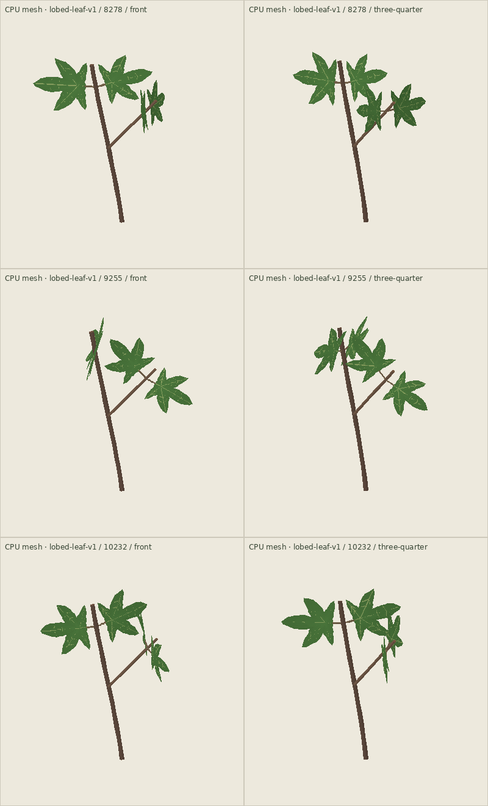

# Sparse lobed-leaf branch

Implemented on the PR #90 source base (`3226687`) as a playable additive study,
not an alteration to the old leafy shoot or a claim of completed phone acceptance.

## What it adds

`lobed-leaf-v1`, tray ID `lobed-leaf`, has one short woody line, one subordinate
fork and four leaf organs at two opposite attachment nodes. All four are simple
connected blades: five lobes with four deep open notches, not five independent
leaflets. The default is green. The blade's radiating veins and slight asymmetric
outline are deterministic from the stable organ identity and graph seed.

The reason to try it is a few broad angular faces around open wood. Pruning the
existing shoot or fan cannot join their separate elliptic blades into this face.
One petiole cut removes one whole blade; cutting the fork opens a two-leaf window.
Wood and fork use ordinary Bend. Pressing a leaf uses the actual surface grip to
Aim its supporting petiole. There are no per-lobe handles, blade bending or new
roll control. Those existing control limits remain relevant to owner play.

The botanical reference is [NC State Extension: Acer palmatum](https://plants.ces.ncsu.edu/plants/acer-palmatum/),
read 2026-10-13, which describes opposite simple leaves with five to nine lobes.
This is a restrained maple-inspired cutting, not a named-species growth model.

## Integration and picking

- Existing generators, saved graphs and frozen Workbench profiles stay unchanged.
- The new generator is registered normally before startup hydration, not behind
  a query-time registration flag. The new single-material Workbench choice and
  Materials picker use that same durable registration.
- The schema remains 1. Existing identity, rest lengths and inactive history are
  authoritative. New saved graphs require a build supporting `lobed-leaf-v1`;
  older builds reject the unsupported generator rather than partially loading it.
- Each new blade opts into an independent copy of its exact lamina and vein
  triangles as the hit mesh. An empty notch does not select that leaf. Older
  materials retain their acquisition envelopes. The shared stem/handle fallback
  is unchanged; a real stem visible through a notch can still be selected.
- One leaf uses 462 lamina triangles and 208 vein triangles in two visible meshes;
  its invisible acquisition mesh duplicates those 670 triangles. No textures,
  per-frame leaf remeshing or per-lobe objects are added. All geometries and
  materials follow the existing disposal ownership. The full uncut cutting has
  3,460 visible triangles in 14 visible meshes for the three illustrated seeds,
  excluding acquisition meshes and shadow passes; this is a geometry census,
  not a measured draw-call or frame-time result.

## Evidence

`npm run verify`: **495 tests passed, zero failed/skipped**; typecheck, Vite build,
standalone generation and distribution validation passed. Seven focused new tests
cover five seeds, one golden fixture, opposite shared nodes, Aim/Bend rest lengths,
whole-leaf and fork cuts, exact inactive-history retention, cancelled insertion /
Aim / Bend / prune without writes, committed cut serialization, connected mesh
topology, finite nondegenerate geometry, deterministic rebuilds, and production
surface picking from both sides with true empty notches. All prior goldens passed.



This contact sheet uses the production meshes and transforms with CPU painter
sorting and simplified shading. It is silhouette evidence only: **no WebGL,
browser interaction, phone, lighting, frame-time or touch claim**. It shows seeds
8278, 9255 and 10232, from Front and three-quarter; no bowl is drawn. Reproduce:

```bash
./node_modules/.bin/esbuild tools/botanical-contact-sheet.ts --bundle --platform=node --format=esm --outfile=/tmp/lobed-mesh.mjs
node /tmp/lobed-mesh.mjs /tmp/lobed-mesh.json --material=lobed-leaf --plants-only
python tools/botanical-contact-sheet.py /tmp/lobed-mesh.json /tmp/lobed-leaf-mesh.png
```

## Owner check

Place one beside a reed or flowering branch. Face one leaf, remove its opposite
partner, inspect the opened gap, then view from Above. Cancel a petiole cut and
reload after a deliberate cut. In close view, try the empty notch and the real
leaf immediately beside it. The open notches deliberately provide no enlarged
leaf halo; whether that trade-off remains comfortable with a finger is unproven.
Keep the material only if its connected face earns a useful compositional role.
